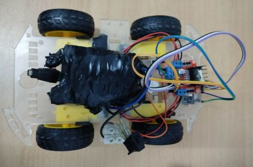

# AI Companion Robot

A collaborative home-robot project by **Mohamed Aziz Turki and Amen Allah Bayoudh**. The four-wheel prototype combines multilingual voice interaction with movement control.

The Raspberry Pi 4 handles speech recognition and spoken responses. Movement commands are sent over MQTT to an ESP32, which controls the motors.

## Project photo

*Four-wheel robot chassis and electronics.*

## Project overview

- Voice interaction designed for Arabic, English, and French.
- Raspberry Pi 4 handles speech processing and response generation.
- An ESP32 controls the mobile base through MQTT commands.

## Repository contents

This repository is a project showcase with a project overview and photo documentation. It does not include the original source code.

---

© reserved to MAT
